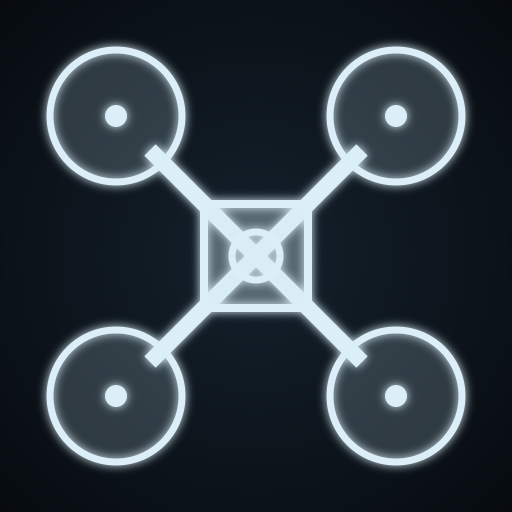

<p align="center">
  
</p>

<h1 align="center">Rotorlab</h1>

<p align="center">
  Darmowa appka z AI do diagnozy i naprawy drona FPV z Betaflight: ESC, test silników, autotune PID z logów, ELRS.
</p>

<p align="center">
  <a href="https://github.com/0nskal/rotorlab/releases/latest"></a>
  
  
  <a href="LICENSE"></a>
</p>

<p align="center">
  <a href="https://github.com/0nskal/rotorlab/releases/latest/download/Rotorlab-Setup.exe"><b>Pobierz na Windows</b></a>
  &nbsp;·&nbsp;
  <a href="https://rotorlab.pages.dev/app/"><b>Otwórz w przeglądarce</b></a>
  &nbsp;·&nbsp;
  <a href="https://rotorlab.pages.dev"><b>Strona</b></a>
</p>

<p align="center">
  
</p>

## Funkcje

- **Diagnoza w minutę.** Odczyt konfiguracji przez MSP i reguły: protokół ESC, bidirectional DShot, napięcie na celę, flagi blokady uzbrojenia. Lista „Co sprawdziłem” pokazuje każdą regułę.
- **Asystent AI.** Z kluczem Anthropic API dopowiada diagnozę i proponuje komendy CLI Betaflight. Bez klucza działają same reguły.
- **ESC bez zgadywania.** Wybór protokołu DShot, przełącznik bidirectional DShot, test silników z blokadą.
- **Autotune z logu.** CSV z `blackbox_decode` lub Blackbox Explorera: widmo gyro, step response z overshootem, PID obecne i sugerowane.
- **ELRS.** Checklista aktualizacji (wersje 3.x, binding phrase, LBT/FCC) i skrót do oficjalnego ELRS Web Flasher.
- **Tryb demo.** Symulowany FC, żeby obejrzeć appkę bez drona.

## Instalacja

### Windows

1. Pobierz [`Rotorlab-Setup.exe`](https://github.com/0nskal/rotorlab/releases/latest/download/Rotorlab-Setup.exe) z najnowszego wydania.
2. Uruchom instalator. Appka nie jest podpisana certyfikatem, więc SmartScreen może pokazać ostrzeżenie: **Więcej informacji → Uruchom mimo to**.

### Przeglądarka

Otwórz [rotorlab.pages.dev/app](https://rotorlab.pages.dev/app/) w **Chrome lub Edge 89+** (WebSerial). Firefox i Safari nie obsługują portu szeregowego.

Wymagania: kabel USB z danymi, Betaflight 4.3+ na kontrolerze lotu.

## Pierwsze uruchomienie

1. Zamknij Betaflight Configurator (zajmuje port) i zdejmij śmigła.
2. Podłącz kontroler lotu kablem USB i kliknij **Połącz**. Nie masz drona pod ręką? Wybierz **Tryb demo**.
3. Opcjonalnie wklej klucz Anthropic API w **Ustawieniach**. Zapisuje się lokalnie, nie trafia do repo ani na żaden serwer Rotorlab.

## Jak to działa

| Co | Skąd |
| --- | --- |
| Odczyt stanu drona (wersja, silniki, napięcie, PID, konfiguracja ESC) | MSP przez WebSerial |
| Zmiana ustawień, `diff all`, `save` | CLI Betaflight przez port szeregowy |
| Diagnoza AI i propozycje komend | Claude API (Anthropic) |
| Autotune PID: widmo i step response | CSV z `blackbox_decode` / Blackbox Explorera |

## Bezpieczeństwo i prywatność

- Przed każdą zmianą Rotorlab zapisuje kopię `diff all`, pokazuje listę komend i czeka na potwierdzenie.
- Test silników działa tylko po zaznaczeniu „Śmigła zdjęte”, ma przycisk STOP i zatrzymuje się po rozłączeniu albo zmianie zakładki.
- Klucz API jest przechowywany lokalnie na Twoim urządzeniu.
- Dane drona (konfiguracja, `diff all`, wynik reguł) trafiają do Anthropic tylko wtedy, gdy zadajesz pytanie asystentowi AI.

## Rozwój

```bash
npm install
npm run dev            # appka w przeglądarce (Vite)
npm run dev:electron   # appka w Electronie
npm run build          # typecheck + build do dist/
npm run dist:win       # instalator Windows do release/
```

### Deploy strony

```bash
npm run build && node scripts/build-site.mjs && npx wrangler pages deploy site --project-name rotorlab
```

Skrypt `scripts/build-site.mjs` kopiuje `dist/` do `site/app/`, dzięki czemu appka w przeglądarce działa pod `/app/`.

## Wydania

Wypchnięcie tagu `v*` (np. `git tag v0.1.0 && git push --tags`) uruchamia GitHub Actions: build na Windows, upload `Rotorlab-Setup.exe` do GitHub Release z automatycznymi notatkami. Workflow CI buduje projekt przy każdym pushu i pull requeście.

## Roadmap

- Flashowanie ELRS z poziomu appki
- Natywne pliki `.bbl` (bez konwersji do CSV)
- macOS i Linux

## Licencja

[MIT](LICENSE)
