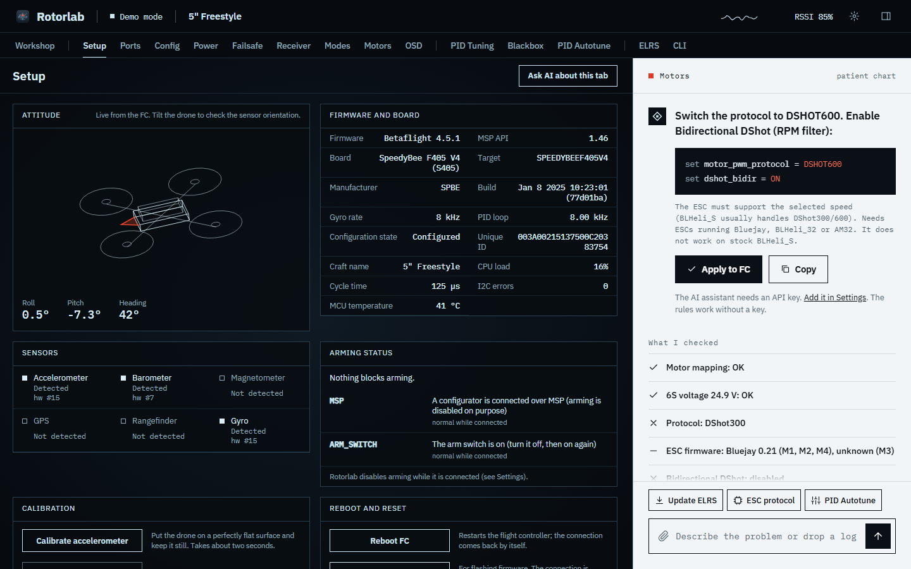
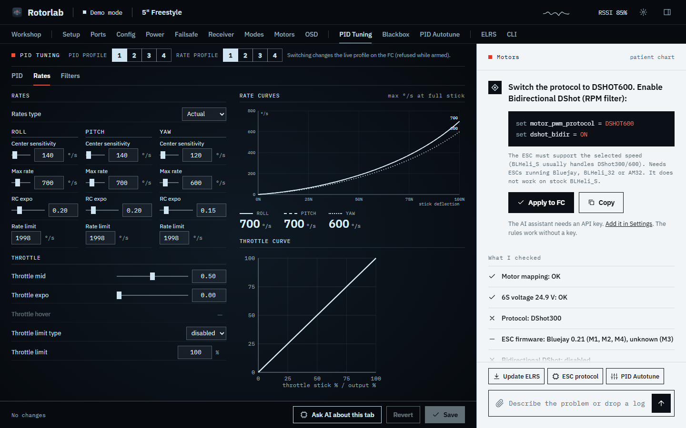

<p align="center">
  
</p>

<h1 align="center">WorkspaceFPV</h1>

<p align="center">
  A free AI-powered app for diagnosing, configuring and fixing FPV drones running Betaflight: the Configurator tabs, ESC and ELRS info, PID autotune from logs.
</p>

<p align="center">
  <a href="https://github.com/0nskal/WorkspaceFPV/releases/latest"></a>
  
  
  <a href="LICENSE"></a>
</p>

<p align="center">
  <a href="https://github.com/0nskal/WorkspaceFPV/releases/latest/download/WorkspaceFPV-Setup.exe"><b>Download for Windows</b></a>
  &nbsp;·&nbsp;
  <a href="https://workspacefpv.pages.dev/app/"><b>Open in the browser</b></a>
  &nbsp;·&nbsp;
  <a href="https://workspacefpv.pages.dev"><b>Website</b></a>
</p>

<p align="center">
  
</p>

<p align="center"><b>English</b> · <a href="#polski">Polski</a> · <a href="CHANGELOG.md">Changelog</a></p>

> **A hobby project made to make our work in the FPV hobby easier.** Free and open source, built by and for FPV pilots. Contributions are welcome through pull requests with screenshots, see [Contributing](#contributing).
>
> Formerly **Rotorlab**. Installs of Rotorlab 0.2.0 update to WorkspaceFPV from **Settings → Updates** and keep their settings.

## Features

- **Diagnosis in a minute.** Reads the whole configuration over MSP when you connect and checks it against rules: ESC protocol, bidirectional DShot, voltage per cell, arming disable flags. The "What I checked" list shows every rule.
- **AI assistant.** Completes the diagnosis and proposes Betaflight CLI commands. The configuration tabs have an "Ask AI about this tab" button. You choose the provider in **Settings → AI assistant**, and you do not need to pay for the Anthropic API:
  - **Claude Code (local, desktop app only):** uses the Claude Code you already have installed and logged in. No key in the app; it counts toward your plan's usage limits. Runs with no tools in an empty temporary folder.
  - **Google Gemini:** a free API key from [aistudio.google.com/apikey](https://aistudio.google.com/apikey) (desktop app and browser). The free tier has rate limits and Google may use free-tier prompts to improve its products.
  - **Local model (Ollama):** a model on your own computer, for example `qwen3:8b` or `llama3.1:8b`. Free and offline. In the browser, set `OLLAMA_ORIGINS` for this page (the settings screen shows how); the desktop app needs no setup.
  - **Anthropic API:** pay-per-use with your own key (as before).
  The answer in the chat shows which provider wrote it. Without any provider the rules still work.
- **Betaflight Configurator tabs.** Everything is read automatically on connect (no "read" buttons) and saved over MSP (SET commands, EEPROM write, reboot and reconnect when needed). Changed fields are marked until you press Save.
  - **Setup:** firmware and board info, live attitude, sensors, arming status, calibration, reboot to DFU/MSC, reset.
  - **Ports:** UART functions and baud rates.
  - **Configuration:** mixer, board alignment, accelerometer trim, PID loop, features, beepers, arming, names.
  - **Power & Battery:** live voltage/current, meter sources and scales, cell limits, voltage scale calculator.
  - **Failsafe:** guard time, procedure, per-channel fallback values.
  - **Receiver:** provider, channel map, RSSI channel, deadbands, RC smoothing, live channel bars and ELRS link quality.
  - **Modes:** AUX ranges for every flight mode with a live channel marker and the modes the FC reports as active.
  - **PID Tuning:** PID/D max/feedforward per profile, rates for all five rate types with live curves, throttle curve, filters with a frequency-response sketch.
  - **Motors:** protocol, bidirectional DShot, idle, motor poles, direction, live ESC telemetry (RPM, temperature, voltage, current), motor test with safety lock.
  - **OSD:** drag-and-drop element layout per profile, warnings, statistics, units and alarms.
  - **Blackbox:** logging device, rate and debug mode, flash usage, download (fast jumbo MSP frames), erase, mass-storage mode; a downloaded log opens straight in Autotune.
  - **CLI:** terminal with history and completion, `diff all` backup, load a diff file.
- **ESC info from the hardware.** Reads firmware, version and settings of every ESC over the 4-way interface (BLHeli_S, Bluejay and AM32 settings; BLHeli_32 only the MCU, its layout is closed). Read-only.
- **ELRS receiver version from the hardware** (CRSF passthrough), update checklist (binding phrase, LBT/FCC) and a shortcut to the official ELRS Web Flasher.
- **Autotune from a log.** Native `.bbl` from the FC or CSV from `blackbox_decode`: gyro spectrum, step response with overshoot, current and suggested PIDs, one click to carry them over to the PID Tuning tab.
- **Matches the firmware.** Rate curves (Betaflight, RaceFlight, KISS, Actual, Quick), the throttle curve, arming flags, beepers, features and port ids are checked against the Betaflight source (4.5 and 2025.12) with unit tests.
- **Demo mode.** A simulated FC so you can explore every tab without a drone.
- **English and Polish.** Switch the language under **Settings** (it applies instantly).

**Tested on hardware vs. not yet:** the Betaflight tabs were built against the MSP protocol from the firmware source and tested against the simulated FC (demo mode) and unit tests. Saving settings, Blackbox download/erase/MSC, the 4-way ESC read and the ELRS passthrough have **not been tested on a real flight controller yet**. Keep a `diff all` backup (the CLI tab makes one in one click) and remove the props.

<p align="center">
  
</p>
<p align="center">
  
</p>

## Install

### Windows

1. Download [`WorkspaceFPV-Setup.exe`](https://github.com/0nskal/WorkspaceFPV/releases/latest/download/WorkspaceFPV-Setup.exe) from the latest release.
2. Run the installer. The app is not code-signed, so SmartScreen may show a warning: **More info → Run anyway**.

### Browser

Open [workspacefpv.pages.dev/app](https://workspacefpv.pages.dev/app/) in **Chrome or Edge 89+** (WebSerial). Firefox and Safari do not support the serial port.

Requirements: a USB data cable, Betaflight 4.3+ on the flight controller.

## First run

1. Close Betaflight Configurator (it holds the port) and remove the props.
2. Plug in the flight controller over USB and click **Connect**. No drone at hand? Choose **Demo mode**.
3. Optionally choose an AI provider in **Settings** (Claude Code, a free Gemini key, a local Ollama model or an Anthropic API key). Keys are stored locally and never go to the repo or any WorkspaceFPV server.

## How it works

| What | Where from |
| --- | --- |
| Reading the configuration (all tabs, on connect) and live data | MSP v1/v2 over WebSerial |
| Saving settings from the tabs | MSP SET commands + EEPROM write |
| AI fixes, `diff all`, CLI tab | Betaflight CLI over the serial port |
| ESC firmware and settings | 4-way interface (read-only) |
| ELRS receiver version | CRSF over `serialpassthrough` |
| AI diagnosis and command proposals | Claude Code CLI, Gemini (`@google/genai`), Ollama or Claude API (Anthropic) |
| PID autotune: spectrum and step response | `.bbl` from the FC or CSV from `blackbox_decode` / Blackbox Explorer |

Architecture of the Betaflight layer: [docs/ARCHITECTURE.md](docs/ARCHITECTURE.md).

## Safety and privacy

- Before every CLI change WorkspaceFPV saves a `diff all` backup, shows the list of commands and waits for confirmation. Tab edits are only sent when you press Save, and never while the drone is armed.
- While connected WorkspaceFPV disables arming (like the Betaflight Configurator); it is released on disconnect.
- The motor test only works after you tick "Props removed", has a STOP button and stops on disconnect or tab change.
- The API key is stored locally on your device.
- Drone data (configuration, `diff all`, rule results) goes to the AI provider you chose (Anthropic, Google, or your own Claude Code login) only when you ask the AI assistant a question. With Ollama it stays on your computer.

## Development

```bash
npm install
npm run dev            # app in the browser (Vite)
npm run dev:electron   # app in Electron
npm run build          # typecheck + build to dist/
npm test               # all node tests
npm run dist:win       # Windows installer to release/
```

Adding a tab: create `app/src/screens/<name>.ts` exporting `mount`, register it in `app/src/screens/registry.ts`, and add its title to `app/src/i18n/en.ts` and `pl.ts`. All user-facing text lives in those two dictionaries (`pl.ts` must satisfy the type of `en.ts`). Betaflight tabs read through `ctx.bf` (see [docs/ARCHITECTURE.md](docs/ARCHITECTURE.md)).

Tests (Node, bundled with esbuild), e.g.:

```bash
npx esbuild app/src/bf/test-firmware.mjs --bundle --platform=node --format=esm --outfile=$TEMP/t.mjs && node $TEMP/t.mjs
```

The same works for `app/src/analysis/test.mjs` and every `app/src/bf/test-*.mjs`.

### Website deploy

```bash
npm run build && node scripts/build-site.mjs && npx wrangler@4.40.0 pages deploy site --project-name workspacefpv --branch main
```

`scripts/build-site.mjs` copies `dist/` to `site/app/`, so the browser app is served under `/app/`. The website (`site/`) is English by default with an EN/PL switch (`?lang=pl` also works).

## Updates

The Windows version updates from inside the app: **Settings → Updates** ("Check for updates", download with a progress bar, "Install and restart"). By default WorkspaceFPV checks for new versions ~5 s after start (you can turn that off in the same place) and shows a quiet notice. A downloaded update also installs itself when you close the app. This applies from version 0.2.0; 0.1.0 has to be downloaded manually once. The browser version updates itself when you reload the page.

## Releases

Process: bump `version` in `package.json` (e.g. `0.3.0`) and add an entry to `CHANGELOG.md`, commit, `git tag v0.3.0 && git push --tags`, and GitHub Actions does the rest. The workflow checks that the tag matches the version in `package.json` (it fails otherwise), builds on Windows and uploads `WorkspaceFPV-Setup.exe`, `WorkspaceFPV-Setup.exe.blockmap` and `latest.yml` (used by the update mechanism) to the GitHub Release.

Pushing a `v*` tag runs GitHub Actions with automatic release notes. The CI workflow builds the project on every push and pull request.

## Roadmap

- Testing the Betaflight tabs on more flight controllers
- Adjustments tab
- Per-motor spin direction and motor order (DShot commands)
- Flashing Betaflight firmware (DFU) and ELRS from inside the app
- macOS and Linux

## Contributing

WorkspaceFPV is a hobby project made to make our work in the FPV hobby easier, and the repository is public. You can't push to it directly: **every change comes as a pull request from your fork, with screenshots of what changed** (before and after when you change something that exists), so we can review it and, if it fits, merge it into the project. The PR template, the automatic checks (title, screenshots, build, tests) and the safety rules for code that talks to a flight controller are described in [CONTRIBUTING.md](CONTRIBUTING.md). Bugs and ideas: open an [issue](https://github.com/0nskal/WorkspaceFPV/issues).

## License

[MIT](LICENSE)

---

## Polski

<p align="center"><a href="#features">English</a> · <b>Polski</b> · <a href="CHANGELOG.md">Historia zmian</a></p>

> **Projekt hobbystyczny, który ma ułatwiać nam pracę w tym hobby (FPV).** Darmowy i otwarty, tworzony przez pilotów FPV dla pilotów FPV. Zmiany mile widziane przez pull requesty ze zrzutami ekranu, zobacz [Współpraca](#współpraca).
>
> Wcześniej **Rotorlab**. Instalacje Rotorlab 0.2.0 zaktualizują się do WorkspaceFPV z **Ustawienia → Aktualizacje** i zachowają ustawienia.

## Funkcje

- **Diagnoza w minutę.** Po połączeniu WorkspaceFPV czyta całą konfigurację przez MSP i sprawdza ją regułami: protokół ESC, bidirectional DShot, napięcie na celę, flagi blokady uzbrojenia. Lista „Co sprawdziłem” pokazuje każdą regułę.
- **Asystent AI.** Dopowiada diagnozę i proponuje komendy CLI Betaflight. Zakładki konfiguracji mają przycisk „Zapytaj AI o tę kartę”. Dostawcę wybierasz w **Ustawienia → Asystent AI** i nie musisz płacić za Anthropic API:
  - **Claude Code (lokalnie, tylko aplikacja desktopowa):** korzysta z Claude Code, który masz zainstalowany i zalogowany. Bez klucza w aplikacji; liczy się do limitów Twojego planu. Działa bez narzędzi w pustym folderze tymczasowym.
  - **Google Gemini:** darmowy klucz API z [aistudio.google.com/apikey](https://aistudio.google.com/apikey) (aplikacja i przeglądarka). Darmowy poziom ma limity zapytań, a Google może używać promptów z darmowego poziomu do ulepszania swoich produktów.
  - **Model lokalny (Ollama):** model na Twoim komputerze, np. `qwen3:8b` albo `llama3.1:8b`. Za darmo i offline. W przeglądarce ustaw `OLLAMA_ORIGINS` dla tej strony (ekran ustawień podpowiada jak); aplikacja desktopowa nie wymaga konfiguracji.
  - **Anthropic API:** płatne za użycie, z własnym kluczem (jak dotąd).
  W czacie widać, który dostawca napisał odpowiedź. Bez żadnego dostawcy działają same reguły.
- **Zakładki jak w Betaflight Configuratorze.** Wszystko czyta się samo przy połączeniu (bez przycisków „odczytaj”), zapis idzie przez MSP (komendy SET, zapis EEPROM, restart i ponowne połączenie, gdy trzeba). Zmienione pola są zaznaczone, dopóki nie klikniesz Zapisz.
  - **Setup:** firmware i płytka, położenie na żywo, czujniki, blokady uzbrojenia, kalibracja, restart do DFU/MSC, reset.
  - **Porty:** funkcje UART i prędkości.
  - **Konfiguracja:** mikser, orientacja płytki, trym akcelerometru, pętla PID, funkcje, beepery, uzbrajanie, nazwy.
  - **Zasilanie:** napięcie i prąd na żywo, źródła i skale mierników, limity ogniw, kalkulator skali napięcia.
  - **Failsafe:** czas ochronny, procedura, wartości zastępcze kanałów.
  - **Odbiornik:** protokół, mapa kanałów, kanał RSSI, martwe strefy, RC smoothing, paski kanałów na żywo i jakość łącza ELRS.
  - **Tryby:** zakresy AUX dla każdego trybu z podglądem kanału i trybami, które FC zgłasza jako aktywne.
  - **Strojenie PID:** PID/D max/feedforward per profil, rates dla wszystkich pięciu typów z krzywymi na żywo, krzywa gazu, filtry ze szkicem charakterystyki.
  - **Silniki:** protokół, bidirectional DShot, idle, liczba biegunów, kierunek, telemetria ESC na żywo (RPM, temperatura, napięcie, prąd), test silników z blokadą.
  - **OSD:** układ elementów przeciąganiem per profil, ostrzeżenia, statystyki, jednostki i alarmy.
  - **Blackbox:** urządzenie, częstotliwość i tryb debug, zajętość flasha, pobieranie (szybkie ramki jumbo MSP), kasowanie, tryb pamięci masowej; pobrany log od razu otwiera się w Autotune.
  - **CLI:** terminal z historią i podpowiedziami, kopia `diff all`, wczytanie pliku diff.
- **Informacje o ESC ze sprzętu.** Firmware, wersja i ustawienia każdego ESC przez interfejs 4-way (ustawienia BLHeli_S, Bluejay i AM32; z BLHeli_32 tylko MCU, bo jego format jest zamknięty). Tylko odczyt.
- **Wersja odbiornika ELRS ze sprzętu** (CRSF passthrough), checklista aktualizacji (binding phrase, LBT/FCC) i skrót do oficjalnego ELRS Web Flasher.
- **Autotune z logu.** Natywny `.bbl` z FC albo CSV z `blackbox_decode`: widmo gyro, step response z overshootem, PID obecne i sugerowane, jednym kliknięciem przenoszone do zakładki Strojenie PID.
- **Zgodność z firmware.** Krzywe rates (Betaflight, RaceFlight, KISS, Actual, Quick), krzywa gazu, flagi uzbrojenia, beepery, funkcje i numery portów są sprawdzone z kodem Betaflight (4.5 i 2025.12) testami jednostkowymi.
- **Tryb demo.** Symulowany FC, żeby obejrzeć każdą zakładkę bez drona.
- **Angielski i polski.** Język przełączysz w **Ustawieniach** (działa od razu).

**Co jest sprawdzone na sprzęcie, a co nie:** zakładki Betaflight powstały na podstawie protokołu MSP z kodu firmware i są przetestowane na symulowanym FC (tryb demo) oraz testami jednostkowymi. Zapis ustawień, pobieranie/kasowanie Blackboxa i tryb MSC, odczyt ESC przez 4-way i passthrough ELRS **nie były jeszcze testowane na prawdziwym kontrolerze lotu**. Zrób kopię `diff all` (zakładka CLI robi ją jednym kliknięciem) i zdejmij śmigła.

## Instalacja

### Windows

1. Pobierz [`WorkspaceFPV-Setup.exe`](https://github.com/0nskal/WorkspaceFPV/releases/latest/download/WorkspaceFPV-Setup.exe) z najnowszego wydania.
2. Uruchom instalator. Appka nie jest podpisana certyfikatem, więc SmartScreen może pokazać ostrzeżenie: **Więcej informacji → Uruchom mimo to**.

### Przeglądarka

Otwórz [workspacefpv.pages.dev/app](https://workspacefpv.pages.dev/app/) w **Chrome lub Edge 89+** (WebSerial). Firefox i Safari nie obsługują portu szeregowego.

Wymagania: kabel USB z danymi, Betaflight 4.3+ na kontrolerze lotu.

## Pierwsze uruchomienie

1. Zamknij Betaflight Configurator (zajmuje port) i zdejmij śmigła.
2. Podłącz kontroler lotu kablem USB i kliknij **Połącz**. Nie masz drona pod ręką? Wybierz **Tryb demo**.
3. Opcjonalnie wybierz dostawcę AI w **Ustawieniach** (Claude Code, darmowy klucz Gemini, lokalny model Ollama albo klucz Anthropic API). Klucze zapisują się lokalnie, nie trafiają do repo ani na żaden serwer WorkspaceFPV.

## Jak to działa

| Co | Skąd |
| --- | --- |
| Odczyt konfiguracji (wszystkie zakładki, przy połączeniu) i dane na żywo | MSP v1/v2 przez WebSerial |
| Zapis ustawień z zakładek | komendy MSP SET + zapis EEPROM |
| Poprawki od AI, `diff all`, zakładka CLI | CLI Betaflight przez port szeregowy |
| Firmware i ustawienia ESC | interfejs 4-way (tylko odczyt) |
| Wersja odbiornika ELRS | CRSF przez `serialpassthrough` |
| Diagnoza AI i propozycje komend | Claude Code CLI, Gemini (`@google/genai`), Ollama lub Claude API (Anthropic) |
| Autotune PID: widmo i step response | `.bbl` z FC albo CSV z `blackbox_decode` / Blackbox Explorera |

Architektura warstwy Betaflight: [docs/ARCHITECTURE.md](docs/ARCHITECTURE.md).

## Bezpieczeństwo i prywatność

- Przed każdą zmianą przez CLI WorkspaceFPV zapisuje kopię `diff all`, pokazuje listę komend i czeka na potwierdzenie. Zmiany w zakładkach idą do FC dopiero po kliknięciu Zapisz i nigdy, gdy dron jest uzbrojony.
- Po połączeniu WorkspaceFPV blokuje uzbrajanie (jak Betaflight Configurator); blokada znika po rozłączeniu.
- Test silników działa tylko po zaznaczeniu „Śmigła zdjęte”, ma przycisk STOP i zatrzymuje się po rozłączeniu albo zmianie zakładki.
- Klucz API jest przechowywany lokalnie na Twoim urządzeniu.
- Dane drona (konfiguracja, `diff all`, wynik reguł) trafiają do wybranego dostawcy AI (Anthropic, Google albo Twoje logowanie Claude Code) tylko wtedy, gdy zadajesz pytanie asystentowi AI. Przy Ollamie zostają na Twoim komputerze.

## Rozwój

```bash
npm install
npm run dev            # appka w przeglądarce (Vite)
npm run dev:electron   # appka w Electronie
npm run build          # typecheck + build do dist/
npm test               # wszystkie testy
npm run dist:win       # instalator Windows do release/
```

Dodanie zakładki: utwórz `app/src/screens/<nazwa>.ts` z eksportem `mount`, zarejestruj go w `app/src/screens/registry.ts` i dopisz tytuł w `app/src/i18n/en.ts` oraz `pl.ts`. Cały tekst interfejsu siedzi w tych dwóch słownikach (`pl.ts` musi spełniać typ z `en.ts`). Zakładki Betaflight czytają dane przez `ctx.bf` (zobacz [docs/ARCHITECTURE.md](docs/ARCHITECTURE.md)).

Testy (Node, bundlowane esbuildem), np. `npx esbuild app/src/bf/test-firmware.mjs --bundle --platform=node --format=esm --outfile=$TEMP/t.mjs && node $TEMP/t.mjs`; tak samo `app/src/analysis/test.mjs` i każdy `app/src/bf/test-*.mjs`.

### Deploy strony

```bash
npm run build && node scripts/build-site.mjs && npx wrangler@4.40.0 pages deploy site --project-name workspacefpv --branch main
```

Skrypt `scripts/build-site.mjs` kopiuje `dist/` do `site/app/`, dzięki czemu appka w przeglądarce działa pod `/app/`. Strona (`site/`) jest domyślnie po angielsku z przełącznikiem EN/PL (działa też `?lang=pl`).

## Aktualizacje

Wersja Windows aktualizuje się z poziomu appki: **Ustawienia → Aktualizacje** (przycisk „Sprawdź aktualizacje”, pobieranie z paskiem postępu, „Zainstaluj i uruchom ponownie”). Domyślnie WorkspaceFPV sprawdza nowe wersje ~5 s po starcie (można wyłączyć tym samym miejscu) i pokazuje dyskretną informację. Pobrana aktualizacja instaluje się też sama po zamknięciu appki. Dotyczy to wersji od 0.2.0; 0.1.0 trzeba raz pobrać ręcznie. Wersja w przeglądarce aktualizuje się sama po odświeżeniu strony.

## Wydania

Proces: podbij `version` w `package.json` (np. `0.3.0`) i dopisz wpis w `CHANGELOG.md`, zacommituj, `git tag v0.3.0 && git push --tags`, a resztę robi GitHub Actions. Workflow sprawdza, że tag zgadza się z wersją w `package.json` (inaczej kończy się błędem), buduje na Windows i wgrywa do GitHub Release `WorkspaceFPV-Setup.exe`, `WorkspaceFPV-Setup.exe.blockmap` oraz `latest.yml` (z tego pliku korzysta mechanizm aktualizacji).

Wypchnięcie tagu `v*` uruchamia GitHub Actions z automatycznymi notatkami wydania. Workflow CI buduje projekt przy każdym pushu i pull requeście.

## Roadmap

- Testy zakładek Betaflight na kolejnych kontrolerach lotu
- Zakładka Adjustments
- Kierunek obrotów i kolejność silników per silnik (komendy DShot)
- Wgrywanie firmware Betaflight (DFU) i ELRS z poziomu appki
- macOS i Linux

## Współpraca

WorkspaceFPV to projekt hobbystyczny, który ma ułatwiać nam pracę w tym hobby, a repozytorium jest publiczne. Nie można pushować do niego bezpośrednio: **każda zmiana przychodzi jako pull request z Twojego forka, ze zrzutami ekranu tego, co się zmieniło** (przed i po, gdy zmieniasz coś istniejącego), żebyśmy mogli to sprawdzić i, jeśli pasuje, wprowadzić do projektu. Szablon PR, automatyczne sprawdzenia (tytuł, zrzuty, build, testy) i zasady bezpieczeństwa dla kodu rozmawiającego z kontrolerem lotu opisuje [CONTRIBUTING.md](CONTRIBUTING.md). Błędy i pomysły: otwórz [issue](https://github.com/0nskal/WorkspaceFPV/issues).

## Licencja

[MIT](LICENSE)
