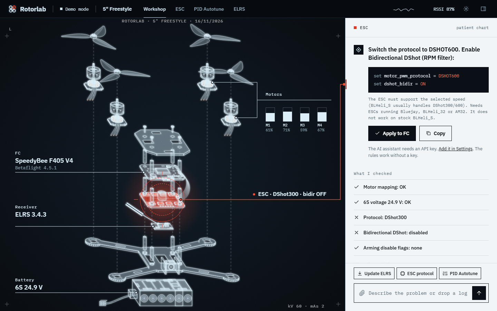

<p align="center">
  
</p>

<h1 align="center">Rotorlab</h1>

<p align="center">
  A free AI-powered app for diagnosing and fixing FPV drones running Betaflight: ESC, motor test, PID autotune from logs, ELRS.
</p>

<p align="center">
  <a href="https://github.com/0nskal/rotorlab/releases/latest"></a>
  
  
  <a href="LICENSE"></a>
</p>

<p align="center">
  <a href="https://github.com/0nskal/rotorlab/releases/latest/download/Rotorlab-Setup.exe"><b>Download for Windows</b></a>
  &nbsp;·&nbsp;
  <a href="https://rotorlab.pages.dev/app/"><b>Open in the browser</b></a>
  &nbsp;·&nbsp;
  <a href="https://rotorlab.pages.dev"><b>Website</b></a>
</p>

<p align="center">
  
</p>

<p align="center"><b>English</b> · <a href="#polski">Polski</a></p>

## Features

- **Diagnosis in a minute.** Reads the configuration over MSP and checks it against rules: ESC protocol, bidirectional DShot, voltage per cell, arming disable flags. The "What I checked" list shows every rule.
- **AI assistant.** With an Anthropic API key it completes the diagnosis and proposes Betaflight CLI commands. Without a key the rules still work.
- **ESC without guessing.** DShot protocol picker, bidirectional DShot switch, motor test with safety lock.
- **Autotune from a log.** CSV from `blackbox_decode` or Blackbox Explorer: gyro spectrum, step response with overshoot, current and suggested PIDs.
- **ELRS.** Update checklist (3.x versions, binding phrase, LBT/FCC) and a shortcut to the official ELRS Web Flasher.
- **Demo mode.** A simulated FC so you can explore the app without a drone.
- **English and Polish.** Switch the language under **Settings** (it applies instantly).

## Install

### Windows

1. Download [`Rotorlab-Setup.exe`](https://github.com/0nskal/rotorlab/releases/latest/download/Rotorlab-Setup.exe) from the latest release.
2. Run the installer. The app is not code-signed, so SmartScreen may show a warning: **More info → Run anyway**.

### Browser

Open [rotorlab.pages.dev/app](https://rotorlab.pages.dev/app/) in **Chrome or Edge 89+** (WebSerial). Firefox and Safari do not support the serial port.

Requirements: a USB data cable, Betaflight 4.3+ on the flight controller.

## First run

1. Close Betaflight Configurator (it holds the port) and remove the props.
2. Plug in the flight controller over USB and click **Connect**. No drone at hand? Choose **Demo mode**.
3. Optionally paste your Anthropic API key in **Settings**. It is stored locally and never goes to the repo or any Rotorlab server.

## How it works

| What | Where from |
| --- | --- |
| Reading drone state (version, motors, voltage, PID, ESC configuration) | MSP over WebSerial |
| Changing settings, `diff all`, `save` | Betaflight CLI over the serial port |
| AI diagnosis and command proposals | Claude API (Anthropic) |
| PID autotune: spectrum and step response | CSV from `blackbox_decode` / Blackbox Explorer |

## Safety and privacy

- Before every change Rotorlab saves a `diff all` backup, shows the list of commands and waits for confirmation.
- The motor test only works after you tick "Props removed", has a STOP button and stops on disconnect or tab change.
- The API key is stored locally on your device.
- Drone data (configuration, `diff all`, rule results) goes to Anthropic only when you ask the AI assistant a question.

## Development

```bash
npm install
npm run dev            # app in the browser (Vite)
npm run dev:electron   # app in Electron
npm run build          # typecheck + build to dist/
npm run dist:win       # Windows installer to release/
```

Adding a tab: create `app/src/screens/<name>.ts` exporting `mount`, register it in `app/src/screens/registry.ts`, and add its title to `app/src/i18n/en.ts` and `pl.ts`. All user-facing text lives in those two dictionaries (`pl.ts` must satisfy the type of `en.ts`).

### Website deploy

```bash
npm run build && node scripts/build-site.mjs && npx wrangler pages deploy site --project-name rotorlab
```

`scripts/build-site.mjs` copies `dist/` to `site/app/`, so the browser app is served under `/app/`. The website (`site/`) is English by default with an EN/PL switch (`?lang=pl` also works).

## Updates

The Windows version updates from inside the app: **Settings → Updates** ("Check for updates", download with a progress bar, "Install and restart"). By default Rotorlab checks for new versions ~5 s after start (you can turn that off in the same place) and shows a quiet notice. A downloaded update also installs itself when you close the app. This applies from version 0.2.0; 0.1.0 has to be downloaded manually once. The browser version updates itself when you reload the page.

## Releases

Process: bump `version` in `package.json` (e.g. `0.2.0`), commit, `git tag v0.2.0 && git push --tags`, and GitHub Actions does the rest. The workflow checks that the tag matches the version in `package.json` (it fails otherwise), builds on Windows and uploads `Rotorlab-Setup.exe`, `Rotorlab-Setup.exe.blockmap` and `latest.yml` (used by the update mechanism) to the GitHub Release.

Pushing a `v*` tag runs GitHub Actions with automatic release notes. The CI workflow builds the project on every push and pull request.

## Roadmap

- Flashing ELRS from inside the app
- Native `.bbl` files (no CSV conversion)
- macOS and Linux

## License

[MIT](LICENSE)

---

## Polski

<p align="center"><a href="#features">English</a> · <b>Polski</b></p>

## Funkcje

- **Diagnoza w minutę.** Odczyt konfiguracji przez MSP i reguły: protokół ESC, bidirectional DShot, napięcie na celę, flagi blokady uzbrojenia. Lista „Co sprawdziłem” pokazuje każdą regułę.
- **Asystent AI.** Z kluczem Anthropic API dopowiada diagnozę i proponuje komendy CLI Betaflight. Bez klucza działają same reguły.
- **ESC bez zgadywania.** Wybór protokołu DShot, przełącznik bidirectional DShot, test silników z blokadą.
- **Autotune z logu.** CSV z `blackbox_decode` lub Blackbox Explorera: widmo gyro, step response z overshootem, PID obecne i sugerowane.
- **ELRS.** Checklista aktualizacji (wersje 3.x, binding phrase, LBT/FCC) i skrót do oficjalnego ELRS Web Flasher.
- **Tryb demo.** Symulowany FC, żeby obejrzeć appkę bez drona.
- **Angielski i polski.** Język przełączysz w **Ustawieniach** (działa od razu).

## Instalacja

### Windows

1. Pobierz [`Rotorlab-Setup.exe`](https://github.com/0nskal/rotorlab/releases/latest/download/Rotorlab-Setup.exe) z najnowszego wydania.
2. Uruchom instalator. Appka nie jest podpisana certyfikatem, więc SmartScreen może pokazać ostrzeżenie: **Więcej informacji → Uruchom mimo to**.

### Przeglądarka

Otwórz [rotorlab.pages.dev/app](https://rotorlab.pages.dev/app/) w **Chrome lub Edge 89+** (WebSerial). Firefox i Safari nie obsługują portu szeregowego.

Wymagania: kabel USB z danymi, Betaflight 4.3+ na kontrolerze lotu.

## Pierwsze uruchomienie

1. Zamknij Betaflight Configurator (zajmuje port) i zdejmij śmigła.
2. Podłącz kontroler lotu kablem USB i kliknij **Połącz**. Nie masz drona pod ręką? Wybierz **Tryb demo**.
3. Opcjonalnie wklej klucz Anthropic API w **Ustawieniach**. Zapisuje się lokalnie, nie trafia do repo ani na żaden serwer Rotorlab.

## Jak to działa

| Co | Skąd |
| --- | --- |
| Odczyt stanu drona (wersja, silniki, napięcie, PID, konfiguracja ESC) | MSP przez WebSerial |
| Zmiana ustawień, `diff all`, `save` | CLI Betaflight przez port szeregowy |
| Diagnoza AI i propozycje komend | Claude API (Anthropic) |
| Autotune PID: widmo i step response | CSV z `blackbox_decode` / Blackbox Explorera |

## Bezpieczeństwo i prywatność

- Przed każdą zmianą Rotorlab zapisuje kopię `diff all`, pokazuje listę komend i czeka na potwierdzenie.
- Test silników działa tylko po zaznaczeniu „Śmigła zdjęte”, ma przycisk STOP i zatrzymuje się po rozłączeniu albo zmianie zakładki.
- Klucz API jest przechowywany lokalnie na Twoim urządzeniu.
- Dane drona (konfiguracja, `diff all`, wynik reguł) trafiają do Anthropic tylko wtedy, gdy zadajesz pytanie asystentowi AI.

## Rozwój

```bash
npm install
npm run dev            # appka w przeglądarce (Vite)
npm run dev:electron   # appka w Electronie
npm run build          # typecheck + build do dist/
npm run dist:win       # instalator Windows do release/
```

Dodanie zakładki: utwórz `app/src/screens/<nazwa>.ts` z eksportem `mount`, zarejestruj go w `app/src/screens/registry.ts` i dopisz tytuł w `app/src/i18n/en.ts` oraz `pl.ts`. Cały tekst interfejsu siedzi w tych dwóch słownikach (`pl.ts` musi spełniać typ z `en.ts`).

### Deploy strony

```bash
npm run build && node scripts/build-site.mjs && npx wrangler pages deploy site --project-name rotorlab
```

Skrypt `scripts/build-site.mjs` kopiuje `dist/` do `site/app/`, dzięki czemu appka w przeglądarce działa pod `/app/`. Strona (`site/`) jest domyślnie po angielsku z przełącznikiem EN/PL (działa też `?lang=pl`).

## Aktualizacje

Wersja Windows aktualizuje się z poziomu appki: **Ustawienia → Aktualizacje** (przycisk „Sprawdź aktualizacje”, pobieranie z paskiem postępu, „Zainstaluj i uruchom ponownie”). Domyślnie Rotorlab sprawdza nowe wersje ~5 s po starcie (można wyłączyć tym samym miejscu) i pokazuje dyskretną informację. Pobrana aktualizacja instaluje się też sama po zamknięciu appki. Dotyczy to wersji od 0.2.0; 0.1.0 trzeba raz pobrać ręcznie. Wersja w przeglądarce aktualizuje się sama po odświeżeniu strony.

## Wydania

Proces: podbij `version` w `package.json` (np. `0.2.0`), zacommituj, `git tag v0.2.0 && git push --tags`, a resztę robi GitHub Actions. Workflow sprawdza, że tag zgadza się z wersją w `package.json` (inaczej kończy się błędem), buduje na Windows i wgrywa do GitHub Release `Rotorlab-Setup.exe`, `Rotorlab-Setup.exe.blockmap` oraz `latest.yml` (z tego pliku korzysta mechanizm aktualizacji).

Wypchnięcie tagu `v*` uruchamia GitHub Actions z automatycznymi notatkami wydania. Workflow CI buduje projekt przy każdym pushu i pull requeście.

## Roadmap

- Flashowanie ELRS z poziomu appki
- Natywne pliki `.bbl` (bez konwersji do CSV)
- macOS i Linux

## Licencja

[MIT](LICENSE)
