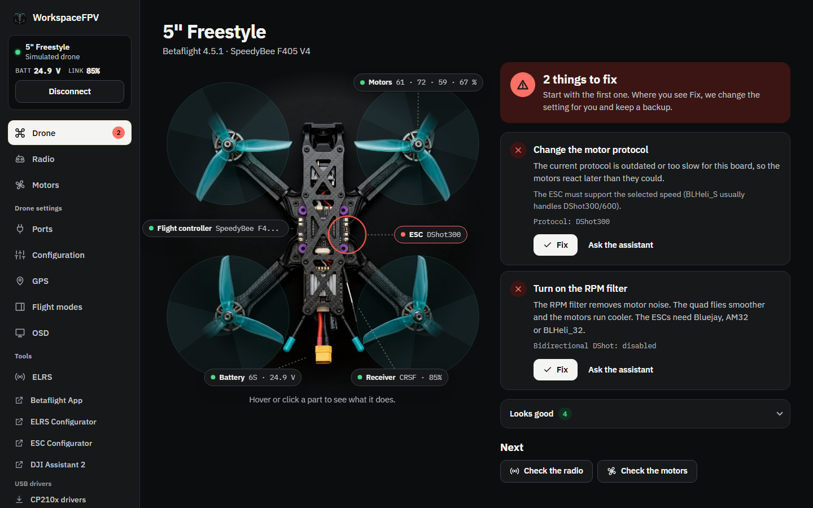
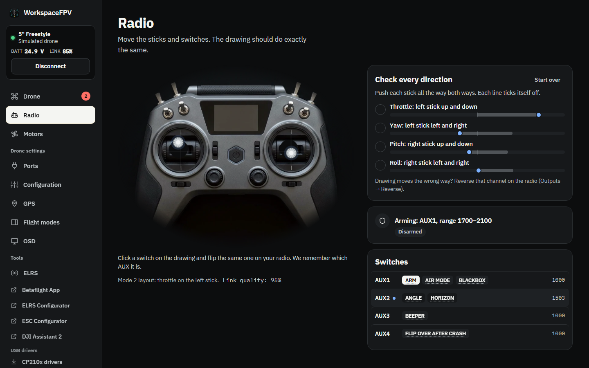
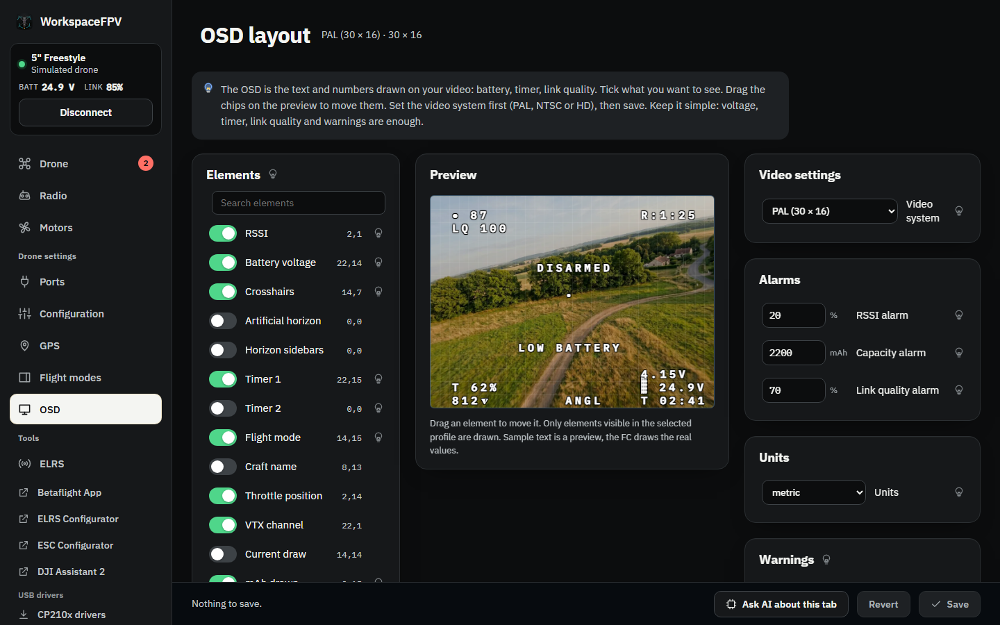
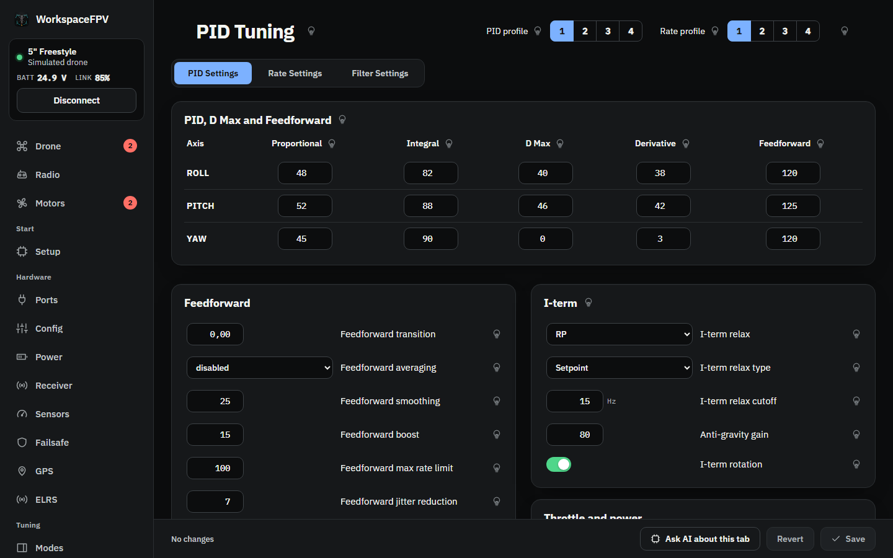

<p align="center">
  
</p>

<h1 align="center">WorkspaceFPV</h1>

<p align="center">
  <b>Plug in your quad. Know what's wrong. Fix it.</b><br>
  A free, open-source Betaflight app with an AI assistant, made by FPV pilots for FPV pilots.
</p>

<p align="center">
  <a href="https://github.com/0nskal/WorkspaceFPV/releases/latest"></a>
  
  
  <a href="LICENSE"></a>
</p>

<p align="center">
  <a href="https://github.com/0nskal/WorkspaceFPV/releases/latest/download/WorkspaceFPV-Setup.exe"><b>Download for Windows</b></a>
  &nbsp;·&nbsp;
  <a href="https://workspacefpv.pages.dev/app/?demo=1"><b>Try the demo (no drone needed)</b></a>
  &nbsp;·&nbsp;
  <a href="https://workspacefpv.pages.dev/app/">Open in the browser</a>
  &nbsp;·&nbsp;
  <a href="https://workspacefpv.pages.dev">Website</a>
</p>

<p align="center">
  
</p>

<p align="center"><b>English</b> · <a href="#polski">Polski</a> · <a href="CHANGELOG.md">Changelog</a></p>

> Formerly **Rotorlab**. Installs of Rotorlab 0.2.0 update to WorkspaceFPV from **Settings → Updates** and keep their settings.

## What it does

|  |  |
| --- | --- |
| **Diagnoses in a minute** | Reads the whole configuration over MSP on connect and checks it against rules (ESC protocol, bidirectional DShot, voltage per cell, arming flags). Problems show on the drone picture in plain words, with a **Fix** button that changes the setting for you, after a backup and a confirmation. |
| **Made for beginners, complete for experts** | *Basic* shows only what it takes to get a quad flying, with a lightbulb explaining every setting. *Expert* gives you every tab and option, like Betaflight Configurator. Switch in the top bar. |
| **Every Betaflight tab** | Setup, Ports, Configuration, Power, Receiver, Modes, PID Tuning, Motors, OSD, GPS, Sensors, Failsafe, Blackbox and CLI. Read on connect, saved over MSP. |
| **AI assistant** | Answers in a few sentences, proposes CLI commands and jumps to the field it means. Draw a box around any part of the window with the scissors button and ask about exactly that. |
| **PID Autotune from a log** | Open a `.bbl` or a CSV: gyro spectrum, step response with overshoot, current and suggested PIDs, one click to carry them over. |
| **ESC and ELRS info** | Firmware and settings of every ESC over 4-way (read-only), ELRS receiver version over CRSF, update checklist. |
| **Demo mode** | A simulated flight controller, so you can click through every tab without a drone. |

## Screenshots

<table>
  <tr>
    <td width="50%"><br><sub><b>Radio.</b> Move the sticks and the drawing follows. Learn which AUX is which switch.</sub></td>
    <td width="50%"><br><sub><b>OSD.</b> Drag elements over a real camera image, in the proportions of your video system.</sub></td>
  </tr>
  <tr>
    <td width="50%"><br><sub><b>PID Tuning.</b> PID, D Max, feedforward, rates with live curves, filters.</sub></td>
  </tr>
</table>

## AI assistant: pick your provider

You choose in **Settings → AI assistant**. You do not need to pay for the Anthropic API, and without any provider the rules still work.

| Provider | Cost | Notes |
| --- | --- | --- |
| **Claude Code** (desktop app) | Your plan's limits | Uses the Claude Code you already have installed and logged in. No key in the app. Runs with no tools in an empty temporary folder. |
| **Google Gemini** | Free tier | A key from [aistudio.google.com/apikey](https://aistudio.google.com/apikey). Rate limits apply, and Google may use free-tier prompts to improve its products. |
| **Ollama** (local model) | Free, offline | For example `qwen3:8b` or `llama3.1:8b`. In the browser set `OLLAMA_ORIGINS` for this page (Settings shows how); the desktop app needs no setup. |
| **Anthropic API** | Pay per use | Your own key. |

Every answer in the chat shows which provider wrote it.

## Install

**Windows:** download [`WorkspaceFPV-Setup.exe`](https://github.com/0nskal/WorkspaceFPV/releases/latest/download/WorkspaceFPV-Setup.exe) and run it. The app is not code-signed, so SmartScreen may warn you: **More info → Run anyway**.

**Browser:** open [workspacefpv.pages.dev/app](https://workspacefpv.pages.dev/app/) in **Chrome or Edge 89+** (WebSerial). Firefox and Safari have no serial port support.

You need a USB data cable and Betaflight 4.3+ on the flight controller.

**First run:**

1. Close Betaflight Configurator (it holds the port) and take the props off.
2. Plug the flight controller in and click **Connect**. No drone at hand? Choose **Demo mode**.
3. Optionally pick an AI provider in **Settings**. Keys stay on your device and never go to the repo or to any WorkspaceFPV server.

The Windows version updates from inside the app (**Settings → Updates**); the browser version updates when you reload.

## Safety and privacy

- Before every CLI change a `diff all` backup is saved, the command list is shown and confirmation is required. Tab edits go to the FC only when you press Save, and never while the drone is armed.
- While connected, arming is disabled (like in Betaflight Configurator) and released on disconnect.
- The motor test needs "Props removed", has a STOP button and stops on disconnect or tab change. Single-motor direction is changed only with an explicit click, a confirmation, a battery, DShot and a disarmed drone.
- ESC access is read-only, apart from that spin direction.
- API keys are stored locally and go only to their own provider. Drone data (configuration, `diff all`, rule results) goes to your chosen provider only when you ask the assistant a question; with Ollama it stays on your computer.

> **Tested on hardware vs. not yet.** The tabs were built against the MSP protocol from the Betaflight source (4.5 and 2025.12) and tested on the simulated FC and with unit tests. Saving settings, Blackbox download/erase/MSC, 4-way ESC read and ELRS passthrough have **not been tested on a real flight controller yet**. Keep a `diff all` backup (one click in the CLI tab) and remove the props.

<details>
<summary><b>All tabs in detail</b></summary>

- **Setup:** firmware and board info, live attitude, sensors, arming status, calibration, reboot to DFU/MSC, reset.
- **Ports:** UART functions and baud rates.
- **Configuration:** mixer, board alignment, accelerometer trim, PID loop, features, beepers, arming, names.
- **Power & Battery:** live voltage and current, meter sources and scales, cell limits, voltage scale calculator.
- **Failsafe:** guard time, procedure, per-channel fallback values.
- **Receiver:** provider, channel map, RSSI channel, deadbands, RC smoothing, live channel bars and ELRS link quality.
- **Modes:** AUX ranges for every flight mode with a live channel marker and the modes the FC reports as active.
- **PID Tuning:** PID/D Max/feedforward per profile, rates for all five rate types with live curves, throttle curve, filters with a frequency-response sketch.
- **Motors:** protocol, bidirectional DShot, idle, motor poles, direction, live ESC telemetry (RPM, temperature, voltage, current), motor test with safety lock.
- **OSD:** drag-and-drop layout per profile, warnings, statistics, units and alarms.
- **GPS:** configuration, satellite table, a real map (Esri tiles, no key) with the home point and the drone.
- **Blackbox:** logging device, rate and debug mode, flash usage, download (fast jumbo MSP frames), erase, mass-storage mode; a downloaded log opens straight in Autotune.
- **CLI:** terminal with history and completion, `diff all` backup, load a diff file.
- **ESC:** BLHeli_S, Bluejay and AM32 settings; BLHeli_32 only the MCU, its layout is closed.
- **Matches the firmware:** rate curves (Betaflight, RaceFlight, KISS, Actual, Quick), the throttle curve, arming flags, beepers, features and port ids are checked against the Betaflight source with unit tests.
- **English and Polish:** switch in **Settings**, it applies instantly.

</details>

<details>
<summary><b>How it works</b></summary>

| What | Where from |
| --- | --- |
| Reading the configuration and live data | MSP v1/v2 over WebSerial |
| Saving settings from the tabs | MSP SET commands + EEPROM write |
| AI fixes, `diff all`, CLI tab | Betaflight CLI over the serial port |
| ESC firmware and settings | 4-way interface (read-only) |
| ELRS receiver version | CRSF over `serialpassthrough` |
| AI diagnosis and command proposals | Claude Code CLI, Gemini (`@google/genai`), Ollama or Claude API |
| PID autotune: spectrum and step response | `.bbl` from the FC or CSV from `blackbox_decode` / Blackbox Explorer |

Architecture of the Betaflight layer: [docs/ARCHITECTURE.md](docs/ARCHITECTURE.md). Tips for the assistant: [docs/TIPS.md](docs/TIPS.md).

</details>

## Development

```bash
npm install
npm run dev            # app in the browser (Vite)
npm run dev:electron   # app in Electron
npm run build          # typecheck + build to dist/
npm test               # all node tests
npm run dist:win       # Windows installer to release/
```

Open `http://localhost:5173/?demo=1` to start in demo mode.

Adding a tab: create `app/src/screens/<name>.ts` exporting `mount`, register it in `app/src/screens/registry.ts`, and add its title to `app/src/i18n/en.ts` and `pl.ts`. All user-facing text lives in those two dictionaries (`pl.ts` must satisfy the type of `en.ts`). Betaflight tabs read through `ctx.bf` (see [docs/ARCHITECTURE.md](docs/ARCHITECTURE.md)).

A single test file (Node, bundled with esbuild), e.g.:

```bash
npx esbuild app/src/bf/test-firmware.mjs --bundle --platform=node --format=esm --outfile=$TEMP/t.mjs && node $TEMP/t.mjs
```

<details>
<summary><b>Website deploy and releases</b></summary>

```bash
npm run build && node scripts/build-site.mjs && npx wrangler@4.40.0 pages deploy site --project-name workspacefpv --branch main
```

`scripts/build-site.mjs` copies `dist/` to `site/app/`, so the browser app is served under `/app/`. The website (`site/`) is English by default with an EN/PL switch (`?lang=pl` also works).

Release: bump `version` in `package.json`, add an entry to `CHANGELOG.md`, commit, `git tag vX.Y.Z && git push --tags`. GitHub Actions checks that the tag matches `package.json`, builds on Windows and uploads `WorkspaceFPV-Setup.exe`, its blockmap and `latest.yml` (used by in-app updates) to the GitHub Release. CI builds every push and pull request.

</details>

## Roadmap

- Testing the Betaflight tabs on more flight controllers
- Adjustments tab
- Motor order (DShot commands)
- Flashing Betaflight firmware (DFU) and ELRS from inside the app
- macOS and Linux

## Contributing

WorkspaceFPV is a hobby project and the repository is public. You can't push to it directly: **every change comes as a pull request from your fork, with screenshots of what changed** (before and after when you change something that exists). The PR template, the automatic checks (title, screenshots, build, tests) and the safety rules for code that talks to a flight controller are in [CONTRIBUTING.md](CONTRIBUTING.md). Bugs and ideas: open an [issue](https://github.com/0nskal/WorkspaceFPV/issues).

Older README versions and screenshots are kept in [docs/archive](docs/archive).

## License

[MIT](LICENSE)

---

## Polski

<p align="center"><a href="#workspacefpv">English</a> · <b>Polski</b> · <a href="CHANGELOG.md">Historia zmian</a></p>

> Wcześniej **Rotorlab**. Instalacje Rotorlab 0.2.0 zaktualizują się do WorkspaceFPV z **Ustawienia → Aktualizacje** i zachowają ustawienia.

### Co robi

|  |  |
| --- | --- |
| **Diagnoza w minutę** | Po połączeniu czyta całą konfigurację przez MSP i sprawdza ją regułami (protokół ESC, bidirectional DShot, napięcie na celę, flagi blokady uzbrojenia). Problemy widać na rysunku drona, opisane prostymi słowami, z przyciskiem **Napraw**, który zmienia ustawienie za Ciebie, po kopii zapasowej i potwierdzeniu. |
| **Dla początkujących, kompletne dla ekspertów** | Tryb *podstawowy* pokazuje tylko to, co potrzebne, żeby dron poleciał, a żarówka przy każdym ustawieniu je tłumaczy. Tryb *ekspert* daje wszystkie zakładki i opcje, jak Betaflight Configurator. Przełącznik na górnym pasku. |
| **Wszystkie zakładki Betaflight** | Setup, Porty, Konfiguracja, Zasilanie, Odbiornik, Tryby, Strojenie PID, Silniki, OSD, GPS, Czujniki, Failsafe, Blackbox i CLI. Czytane przy połączeniu, zapisywane przez MSP. |
| **Asystent AI** | Odpowiada w kilku zdaniach, proponuje komendy CLI i przenosi do pola, o które chodzi. Przyciskiem z nożyczkami zaznaczasz prostokątem dowolny fragment okna i pytasz dokładnie o niego. |
| **Autotune PID z logu** | Otwórz `.bbl` albo CSV: widmo gyro, step response z overshootem, PID obecne i sugerowane, jedno kliknięcie przenosi je dalej. |
| **Informacje o ESC i ELRS** | Firmware i ustawienia każdego ESC przez 4-way (tylko odczyt), wersja odbiornika ELRS przez CRSF, checklista aktualizacji. |
| **Tryb demo** | Symulowany kontroler lotu, żeby przeklikać każdą zakładkę bez drona. |

### Zrzuty ekranu

Zrzuty są wyżej, w sekcji [Screenshots](#screenshots): Radio, OSD i Strojenie PID.

### Asystent AI: wybierz dostawcę

Wybierasz w **Ustawienia → Asystent AI**. Nie musisz płacić za Anthropic API, a bez żadnego dostawcy działają same reguły.

| Dostawca | Koszt | Uwagi |
| --- | --- | --- |
| **Claude Code** (aplikacja desktopowa) | Limity Twojego planu | Korzysta z Claude Code, który masz zainstalowany i zalogowany. Bez klucza w aplikacji. Działa bez narzędzi w pustym folderze tymczasowym. |
| **Google Gemini** | Darmowy poziom | Klucz z [aistudio.google.com/apikey](https://aistudio.google.com/apikey). Obowiązują limity zapytań, a Google może używać promptów z darmowego poziomu do ulepszania swoich produktów. |
| **Ollama** (model lokalny) | Za darmo, offline | Np. `qwen3:8b` albo `llama3.1:8b`. W przeglądarce ustaw `OLLAMA_ORIGINS` dla tej strony (Ustawienia podpowiadają jak); aplikacja desktopowa nie wymaga konfiguracji. |
| **Anthropic API** | Płatne za użycie | Własny klucz. |

W czacie widać, który dostawca napisał odpowiedź.

### Instalacja

**Windows:** pobierz [`WorkspaceFPV-Setup.exe`](https://github.com/0nskal/WorkspaceFPV/releases/latest/download/WorkspaceFPV-Setup.exe) i uruchom. Appka nie jest podpisana certyfikatem, więc SmartScreen może ostrzec: **Więcej informacji → Uruchom mimo to**.

**Przeglądarka:** otwórz [workspacefpv.pages.dev/app](https://workspacefpv.pages.dev/app/) w **Chrome lub Edge 89+** (WebSerial). Firefox i Safari nie obsługują portu szeregowego.

Potrzebujesz kabla USB z danymi i Betaflight 4.3+ na kontrolerze lotu.

**Pierwsze uruchomienie:**

1. Zamknij Betaflight Configurator (zajmuje port) i zdejmij śmigła.
2. Podłącz kontroler lotu i kliknij **Połącz**. Nie masz drona pod ręką? Wybierz **Tryb demo**.
3. Opcjonalnie wybierz dostawcę AI w **Ustawieniach**. Klucze zostają na Twoim urządzeniu, nie trafiają do repo ani na żaden serwer WorkspaceFPV.

Wersja Windows aktualizuje się z poziomu appki (**Ustawienia → Aktualizacje**); wersja w przeglądarce po odświeżeniu strony.

### Bezpieczeństwo i prywatność

- Przed każdą zmianą przez CLI zapisuje się kopia `diff all`, pokazuje listę komend i czeka na potwierdzenie. Zmiany w zakładkach idą do FC dopiero po kliknięciu Zapisz i nigdy, gdy dron jest uzbrojony.
- Po połączeniu uzbrajanie jest zablokowane (jak w Betaflight Configuratorze), blokada znika po rozłączeniu.
- Test silników wymaga „Śmigła zdjęte”, ma przycisk STOP i zatrzymuje się po rozłączeniu albo zmianie zakładki. Kierunek pojedynczego silnika zmienia się tylko po jawnym kliknięciu, potwierdzeniu, z baterią, DShot i rozbrojonym dronem.
- Dostęp do ESC jest tylko do odczytu, poza tym kierunkiem obrotów.
- Klucze API zostają lokalnie i trafiają tylko do swojego dostawcy. Dane drona (konfiguracja, `diff all`, wynik reguł) idą do wybranego dostawcy tylko wtedy, gdy zadajesz pytanie asystentowi; przy Ollamie zostają na Twoim komputerze.

> **Co sprawdzone na sprzęcie, a co nie.** Zakładki powstały na podstawie protokołu MSP z kodu Betaflight (4.5 i 2025.12) i są przetestowane na symulowanym FC oraz testami jednostkowymi. Zapis ustawień, pobieranie/kasowanie Blackboxa i tryb MSC, odczyt ESC przez 4-way i passthrough ELRS **nie były jeszcze testowane na prawdziwym kontrolerze lotu**. Zrób kopię `diff all` (jedno kliknięcie w zakładce CLI) i zdejmij śmigła.

<details>
<summary><b>Wszystkie zakładki w szczegółach</b></summary>

- **Setup:** firmware i płytka, położenie na żywo, czujniki, blokady uzbrojenia, kalibracja, restart do DFU/MSC, reset.
- **Porty:** funkcje UART i prędkości.
- **Konfiguracja:** mikser, orientacja płytki, trym akcelerometru, pętla PID, funkcje, beepery, uzbrajanie, nazwy.
- **Zasilanie:** napięcie i prąd na żywo, źródła i skale mierników, limity ogniw, kalkulator skali napięcia.
- **Failsafe:** czas ochronny, procedura, wartości zastępcze kanałów.
- **Odbiornik:** protokół, mapa kanałów, kanał RSSI, martwe strefy, RC smoothing, paski kanałów na żywo i jakość łącza ELRS.
- **Tryby:** zakresy AUX dla każdego trybu z podglądem kanału i trybami, które FC zgłasza jako aktywne.
- **Strojenie PID:** PID/D Max/feedforward per profil, rates dla wszystkich pięciu typów z krzywymi na żywo, krzywa gazu, filtry ze szkicem charakterystyki.
- **Silniki:** protokół, bidirectional DShot, idle, liczba biegunów, kierunek, telemetria ESC na żywo (RPM, temperatura, napięcie, prąd), test silników z blokadą.
- **OSD:** układ przeciąganiem per profil, ostrzeżenia, statystyki, jednostki i alarmy.
- **GPS:** konfiguracja, tabela satelitów, prawdziwa mapa (kafelki Esri, bez klucza) z punktem domowym i dronem.
- **Blackbox:** urządzenie, częstotliwość i tryb debug, zajętość flasha, pobieranie (szybkie ramki jumbo MSP), kasowanie, tryb pamięci masowej; pobrany log od razu otwiera się w Autotune.
- **CLI:** terminal z historią i podpowiedziami, kopia `diff all`, wczytanie pliku diff.
- **ESC:** ustawienia BLHeli_S, Bluejay i AM32; z BLHeli_32 tylko MCU, bo jego format jest zamknięty.
- **Zgodność z firmware:** krzywe rates (Betaflight, RaceFlight, KISS, Actual, Quick), krzywa gazu, flagi uzbrojenia, beepery, funkcje i numery portów są sprawdzone z kodem Betaflight testami jednostkowymi.
- **Angielski i polski:** język przełączysz w **Ustawieniach**, działa od razu.

</details>

<details>
<summary><b>Jak to działa</b></summary>

| Co | Skąd |
| --- | --- |
| Odczyt konfiguracji i dane na żywo | MSP v1/v2 przez WebSerial |
| Zapis ustawień z zakładek | komendy MSP SET + zapis EEPROM |
| Poprawki od AI, `diff all`, zakładka CLI | CLI Betaflight przez port szeregowy |
| Firmware i ustawienia ESC | interfejs 4-way (tylko odczyt) |
| Wersja odbiornika ELRS | CRSF przez `serialpassthrough` |
| Diagnoza AI i propozycje komend | Claude Code CLI, Gemini (`@google/genai`), Ollama lub Claude API |
| Autotune PID: widmo i step response | `.bbl` z FC albo CSV z `blackbox_decode` / Blackbox Explorera |

Architektura warstwy Betaflight: [docs/ARCHITECTURE.md](docs/ARCHITECTURE.md). Wskazówki do asystenta: [docs/TIPS.md](docs/TIPS.md).

</details>

### Rozwój

Polecenia (`npm install`, `npm run dev`, `npm run dev:electron`, `npm run build`, `npm test`, `npm run dist:win`), dodawanie zakładek, testy, deploy strony i proces wydań opisuje sekcja [Development](#development) powyżej. Tryb demo: `http://localhost:5173/?demo=1`. Cały tekst interfejsu siedzi w `app/src/i18n/en.ts` i `pl.ts` (`pl.ts` musi spełniać typ z `en.ts`).

### Roadmap

- Testy zakładek Betaflight na kolejnych kontrolerach lotu
- Zakładka Adjustments
- Kolejność silników (komendy DShot)
- Wgrywanie firmware Betaflight (DFU) i ELRS z poziomu appki
- macOS i Linux

### Współpraca

WorkspaceFPV to projekt hobbystyczny, a repozytorium jest publiczne. Nie można pushować do niego bezpośrednio: **każda zmiana przychodzi jako pull request z Twojego forka, ze zrzutami ekranu tego, co się zmieniło** (przed i po, gdy zmieniasz coś istniejącego). Szablon PR, automatyczne sprawdzenia (tytuł, zrzuty, build, testy) i zasady bezpieczeństwa dla kodu rozmawiającego z kontrolerem lotu opisuje [CONTRIBUTING.md](CONTRIBUTING.md). Błędy i pomysły: otwórz [issue](https://github.com/0nskal/WorkspaceFPV/issues).

Starsze wersje README i zrzuty ekranu są w [docs/archive](docs/archive).

### Licencja

[MIT](LICENSE)
